<div align="center">

# ⚖️ Arabic Legal RAG — Egyptian Civil Code Q&A

**Ask about the Egyptian Civil Code in Arabic or English and get an answer that cites the articles it is based on.**

[](https://github.com/sara692/Egyptian-Civil-Code-QA/actions/workflows/ci.yml)


<!-- Tool badges: a logo that shields.io does not know simply renders without the icon -->


</div>

> **Not legal advice.** This is a study and engineering project. Answers can be wrong or incomplete. Check the cited article before relying on it.

---

## Contents

1. [Overview](#overview)
2. [Tools used](#tools-used)
3. [Project layout](#project-layout)
4. [Quick start](#quick-start)
5. [Configuration](#configuration)
6. [Phases](#phases) — [0](#phase-0--setup) · [1](#phase-1--build-the-corpus) · [2](#phase-2--validate-the-corpus) · [3](#phase-3--chunking-embeddings-vector-store) · [4](#phase-4--generation-and-citations) · [5](#phase-5--fastapi-and-docker) · [6](#phase-6--experiment-tracking-mlflow--ragas) · [7](#phase-7--ci-with-github-actions) · [8](#phase-8--serving) · [9](#phase-9--optimization) · [10](#phase-10--monitoring)
7. [Port map](#port-map)
8. [Evaluation results](#evaluation-results)
9. [Design decisions](#design-decisions)
10. [Not done / limitations](#not-done--limitations)

---

## Overview

```
question ─► normalize ─► embed (API) ─► Chroma search ─► select articles ─► LLM (API) ─► answer + citations
                          bge-m3         data/index_bge    min_score,         Gemma 31B
                                                           article lookup
```

- **One article = one chunk.** All 1,094 articles are indexed, each as one document with one normalized Arabic field (`text_ar`).
- **Article-number questions** ("المادة 147", "article 147") skip vector search and fetch that article directly.
- **Answers come only from the retrieved articles.** Sources are checked against what was retrieved; if nothing relevant is found, or the article is repealed, the system says so instead of guessing.
- **Embeddings and the LLM are used through APIs**, so no GPU is needed.
- Delivered through a **FastAPI** API, a **BentoML** streaming service and a **Streamlit** chat UI, with CI quality gates and a monitoring stack.

---

## Tools used

|     | Tool                           | Used for                                             | Phase |
| --- | ------------------------------ | ---------------------------------------------------- | ----- |
| 📦  | **uv**                         | Python environment, lock file, running commands      | 0     |
| 🌿  | **Git / GitHub**               | Version control, pull requests                       | all   |
| 🗃️  | **DVC**                        | Versioning the raw PDF and the early pipeline stages | 0–2   |
| 🧹  | **Ruff, Black, pre-commit**    | Lint, format, commit checks                          | 0     |
| 📄  | **pdfplumber**                 | PDF table extraction                                 | 1     |
| ✅  | **pytest**                     | Corpus validation, unit and API tests                | 2–5   |
| 🧠  | **OpenRouter (bge-m3)**        | Embeddings API                                       | 3     |
| 🗄️  | **ChromaDB**                   | Vector store                                         | 3     |
| 🤖  | **Gemma 31B via Ollama cloud** | Answer generation                                    | 4     |
| 🚀  | **FastAPI + Pydantic**         | REST API                                             | 5     |
| 🐳  | **Docker / Compose**           | Packaging and running the API                        | 5     |
| 📊  | **MLflow**                     | Experiments, model registry, quality trend           | 6, 10 |
| 🎯  | **RAGAS**                      | Answer-quality scoring                               | 6, 10 |
| ⚙️  | **GitHub Actions**             | CI: lint, test, evaluate, build image                | 7     |
| 🍱  | **BentoML**                    | Async and streaming service                          | 8     |
| 💬  | **Streamlit**                  | Chat UI                                              | 8     |
| 🐝  | **Locust**                     | Load testing                                         | 8     |
| 🔀  | **nginx**                      | Canary traffic split                                 | 8     |
| 🔭  | **Langfuse**                   | Traces, scores, users, sessions, token usage         | 10    |
| 📈  | **Prometheus**                 | Metrics                                              | 10    |
| 🖥️  | **Grafana**                    | Dashboards                                           | 10    |
| 🔔  | **Alertmanager**               | Alert notifications                                  | 10    |

---

## Project layout

```
.
├── src/arabic_legal_rag/
│   ├── ingestion/        # PDF → corpus, normalisation, chunker, embedder, index build
│   ├── retrieval/        # Chroma search, article-number lookup
│   ├── generation/       # prompts, LLM client, answer + citation checks
│   ├── api/              # FastAPI app (/ask, /health, /metrics)
│   ├── serving/          # BentoML service (async + streaming)
│   ├── observability/    # Langfuse tracing, Prometheus metrics, scoring
│   ├── monitoring/       # RAGAS trend runner
│   ├── evaluation/       # RAGAS evaluation, experiments, CI gate
│   └── rag.py            # query() entry point
├── ui/streamlit_app.py   # chat UI
├── tests/                # unit tests; tests/load/locustfile.py for Locust
├── scripts/              # diagnostics, probes, batch re-indexing
├── data/
│   ├── raw/              # the source PDF
│   ├── processed/civil_code.json   # the corpus (1,094 articles)
│   └── eval/             # question sets for evaluation
├── infra/monitoring/     # Prometheus, Alertmanager, Grafana config
├── docker-compose.yml            # the API
├── docker-compose.monitoring.yml # Prometheus + Alertmanager + Grafana
├── docker-compose.canary.yml     # stable / canary behind nginx
├── params.yaml           # pipeline settings
├── .github/workflows/ci.yml
└── docs/images/          # screenshots used in this README
```

---

## Quick start

**Requirements:** Python 3.11+, [uv](https://docs.astral.sh/uv/), Docker, and API keys for an embeddings provider and an LLM provider.

```bash
git clone https://github.com/sara692/Egyptian-Civil-Code-QA.git
cd Egyptian-Civil-Code-QA

cp .env.example .env              # then fill in your values (see Configuration)
uv sync --all-extras              # project + every optional extra

# build the vector index (calls the embeddings API once)
uv run --no-sync python -m arabic_legal_rag.ingestion.index

# API on :8000, then open http://localhost:8000/docs
uv run --no-sync uvicorn arabic_legal_rag.api.main:app --port 8000

# chat UI on :8501
uv run --no-sync streamlit run ui/streamlit_app.py
```

> 💡 A plain `uv sync` removes optional extras. Use `uv sync --all-extras` and `uv run --no-sync …`.

---

## Configuration

Pipeline settings live in `params.yaml`. Secrets and endpoints live in `.env`, which is **never committed**. Write values as plain `KEY=value`: no quotes, no `export`, no spaces around `=`.

| Variable                                                          | Purpose                                |
| ----------------------------------------------------------------- | -------------------------------------- |
| `LLM_BASE_URL`, `LLM_MODEL`, `LLM_API_KEY`                        | Generator (OpenAI-compatible API)      |
| `JUDGE_BASE_URL`, `JUDGE_MODEL`, `JUDGE_API_KEY`                  | Judge model for RAGAS                  |
| `EMBED_BASE_URL`, `EMBED_API_KEY`                                 | Embeddings API                         |
| `LLM_PRICE_IN_PER_M`, `LLM_PRICE_OUT_PER_M`                       | Price per million tokens (cost metric) |
| `LANGFUSE_PUBLIC_KEY`, `LANGFUSE_SECRET_KEY`, `LANGFUSE_BASE_URL` | Tracing (off when unset)               |
| `MLFLOW_TRACKING_URI`                                             | Experiment tracking                    |

---

# Phases

Each phase lists a short summary of the steps, the basic commands, and a spot for screenshots.

## Phase 0 — Setup

**Goal:** a reproducible project with a clean environment and quality checks.

**Steps**

1. Create the repo and a Python 3.11 environment with `uv`.
2. Create the `src/` package skeleton and the data, tests, scripts and deploy folders.
3. Configure `pyproject.toml` (dependencies, optional extras, Ruff/Black/pytest settings).
4. Add `.gitignore`, then pre-commit hooks (Ruff, Black, whitespace, large-file check).
5. Track the raw PDF with DVC and make the first commit.

**Commands**

```bash
git init -b main
uv init --lib --name arabic-legal-rag --python 3.11
uv sync
uv run python -c "import arabic_legal_rag as m; print('ok', m.__version__)"

uv run pre-commit install
uv run pre-commit run --all-files

uv run dvc init
uv run dvc add data/raw/egyptian_civil_code.pdf
```

---

## Phase 1 — Build the corpus

**Goal:** turn the PDF into structured JSON, one record per article.

**Steps**

1. Inspect the PDF layout (Arabic rendering, bilingual tables, repealed articles 54–80).
2. Normalise Arabic text: NFKC, strip diacritics and tatweel, unify alef and ya forms, map Arabic-Indic digits.
3. Parse the PDF with `pdfplumber`, tracking the hierarchy (part, book, chapter, section, topic) and detecting article boundaries.
4. Build article records (number, text, hierarchy, page, citation) and flag repealed articles without dropping them.
5. Spot-check 20 random records by hand.
6. Wire extraction and validation as DVC stages.

**Commands**

```bash
uv run python -m arabic_legal_rag.ingestion.build_corpus \
    data/raw/egyptian_civil_code.pdf data/processed/civil_code.json
uv run dvc repro
```

> 📷 **Phase 1** — one article record from `civil_code.json`.

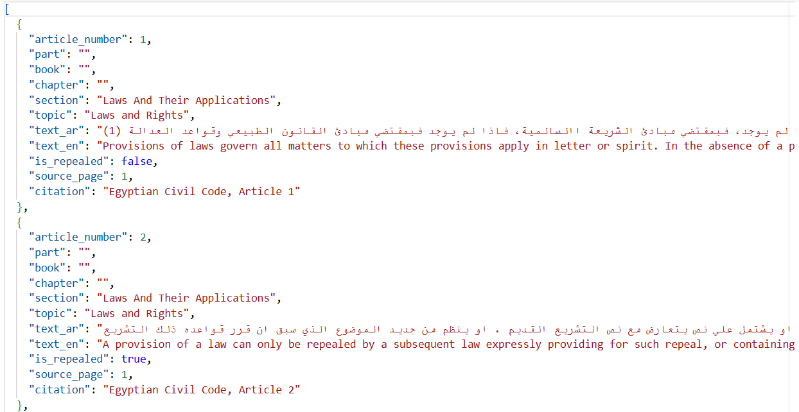

---

## Phase 2 — Validate the corpus

**Goal:** make sure the corpus is trustworthy before embedding it, because a silent parsing bug becomes a wrong answer later.

**Steps**

1. Generate a diagnostics report: missing and duplicate numbers, length outliers, repealed range, empty hierarchy fields.
2. Fix the extractor, not the tests. Document real gaps in the source in `DOCUMENTED_GAPS`.
3. Enforce the rules with `pytest`: integer, sorted, unique and contiguous article numbers; Arabic text present.
4. Re-run the pipeline and commit.

**Commands**

```bash
uv run python scripts/corpus_diagnostics.py
uv run pytest tests/test_corpus_validation.py -q
uv run dvc repro
```

---

## Phase 3 — Chunking, embeddings, vector store

**Goal:** `ingest()` builds an index, and a question returns the right articles with citations.

**Steps**

1. Keep every tunable value in `params.yaml`.
2. Chunk: one article is one chunk, never split. Each chunk carries its article number, citation, repealed flag and hierarchy.
3. Embed with `baai/bge-m3` through the embeddings API (normalised vectors, no prefixes needed) and store in Chroma (cosine).
4. Add article-number lookup so "المادة 147" fetches Article 147 directly.
5. Build the retriever: lookup hits first, then dense hits sorted by score, de-duplicated.
6. Run a retrieval probe (hit@1, hit@5, MRR per language) to choose the embedding model.

**Commands**

```bash
uv run --no-sync python -m arabic_legal_rag.ingestion.index        # build data/index_bge
uv run --no-sync python scripts/retrieval_probe.py
uv run --no-sync pytest tests/test_chunker.py tests/test_article_lookup.py -q
```

---

## Phase 4 — Generation and citations

**Goal:** an LLM that answers only from the retrieved articles, with sources a lawyer can verify.

**Steps**

1. Choose the LLM (Gemma 31B through an OpenAI-compatible API) and keep its settings in `.env`.
2. Write Arabic and English prompts: use only the context, cite `[N]`, refuse when the context is insufficient.
3. Build the LLM client and the citation checker: a cited article that was not retrieved is dropped.
4. Answer pipeline: a repealed article is answered from code without an LLM call; no valid citation means "not found".
5. Calibrate `min_score` on in-domain and off-topic questions.
6. Write the evaluation question sets (answerable, off-topic, repealed).

**Commands**

```bash
uv run --no-sync python -c "from arabic_legal_rag import rag; print(rag.query('ما هي شروط العقد؟'))"
uv run --no-sync pytest tests/test_citations.py tests/test_answer.py -q
uv run --no-sync python scripts/compare_llms.py
```

---

## Phase 5 — FastAPI and Docker

**Goal:** serve the pipeline over HTTP and package it as a container.

**Steps**

1. Define request and response models (Pydantic) and the endpoints `POST /ask`, `GET /health`, `GET /metrics`.
2. Fail fast at startup if the index is missing or was built with other parameters.
3. Map errors: `422` for invalid input, `503` for an unconfigured or unreachable backend.
4. Test the API in-process with `TestClient`, with the index, LLM and tracing replaced by fakes.
5. Write the `Dockerfile` and `docker-compose.yml`; keep secrets out of the image.

**Commands**

```bash
uv run --no-sync uvicorn arabic_legal_rag.api.main:app --port 8000      # http://localhost:8000/docs
uv run --no-sync pytest -m "not slow" -q

docker compose up --build
docker compose ps                     # wait for (healthy)
curl -s localhost:8000/health
```

---

## Phase 6 — Experiment tracking (MLflow + RAGAS)

**Goal:** compare configurations (embedding model × chunk text), log every run, and register the best one.

**Steps**

1. Start the MLflow server (SQLite backend, local artifact folder).
2. Score each configuration with RAGAS (faithfulness, answer relevancy, context precision, context recall) plus pipeline metrics.
3. Run the grid: one MLflow run per configuration, each with its own index; log parameters, metrics and artifacts.
4. Register the best configuration with the alias `production`.

**Commands**

```bash
uv run --no-sync mlflow server --host 127.0.0.1 --port 5000 \
    --backend-store-uri sqlite:///mlflow.db --default-artifact-root ./mlartifacts

uv run --no-sync python -m arabic_legal_rag.evaluation.run_experiment
uv run --no-sync python -m arabic_legal_rag.evaluation.register_best
```

> 📷 **MLflow comparison** — the run comparison chart.

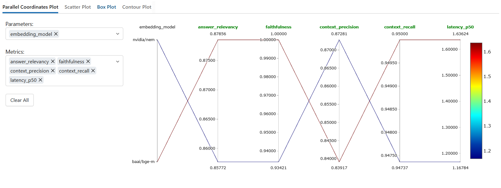

---

## Phase 7 — CI with GitHub Actions

**Goal:** every change is checked automatically; a drop in answer quality fails the build.

**Steps**

1. Pipeline: `lint` → `test` → `evaluate` → `docker` (the image job runs only on pushes to `main`).
2. `evaluate` builds the index and runs a quality gate on the 20-question CI set (faithfulness must stay at or above 0.75).
3. Store API keys as repository **secrets** and endpoints and model names as repository **variables**.
4. Work through pull requests; protect `main` with required checks.

**Commands**

```bash
uv run --no-sync ruff check src tests scripts
uv run --no-sync black --check src tests scripts
uv run --no-sync pytest -m "not slow" -q

git checkout -b feat/my-change
git push -u origin feat/my-change
gh pr create --base main --head feat/my-change
gh pr checks
```

> 📷 **CI green** — a pull request with all checks passing.

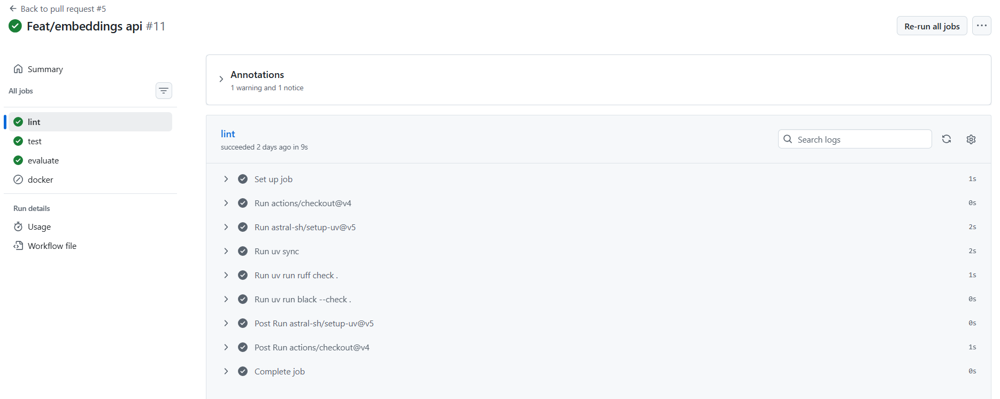

---

## Phase 8 — Serving

**Goal:** a faster, concurrent service, a UI, load numbers, incremental indexing and a safe rollout.

**Steps**

1. **BentoML** service with async `/ask` and token-streaming `/ask_stream` (same logic as the API).
2. **Streamlit** chat UI: Arabic right-to-left, sources, response time, FastAPI or BentoML backend, optional user name and per-conversation session id.
3. **Locust**: 50 simulated users against the service.
4. **Batch re-indexing**: add or update articles without rebuilding the index (Chroma `upsert`).
5. **Canary rollout**: stable and canary containers behind nginx with a percentage split.
6. vLLM serving: **not done** (see [limitations](#not-done--limitations)).

**Commands**

```bash
# BentoML (port 3001 because Langfuse uses 3000)
uv run --no-sync --env-file .env bentoml serve arabic_legal_rag.serving.service:RagService --port 3001
curl -N -X POST localhost:3001/ask_stream -H "Content-Type: application/json" -d @/tmp/q_en.json

# Streamlit
uv run --no-sync streamlit run ui/streamlit_app.py

# Locust: web UI on http://localhost:8089, or headless for a report
uv run --no-sync locust -f tests/load/locustfile.py --host http://localhost:3001
uv run --no-sync locust -f tests/load/locustfile.py --host http://localhost:3001 \
    -u 50 -r 5 -t 3m --headless --html reports/locust_50users.html --csv reports/locust

# Batch re-indexing
uv run --no-sync python scripts/reindex_batch.py

# Canary
docker compose -p canary -f docker-compose.canary.yml up -d
for i in $(seq 1 200); do curl -s -o /dev/null -D - localhost:8080/health | grep -i x-backend; done | sort | uniq -c
```

Every request calls the embeddings and LLM providers, so their rate limits affect the result.

> 📷 **FastAPI** — Swagger page showing a successful /ask response.

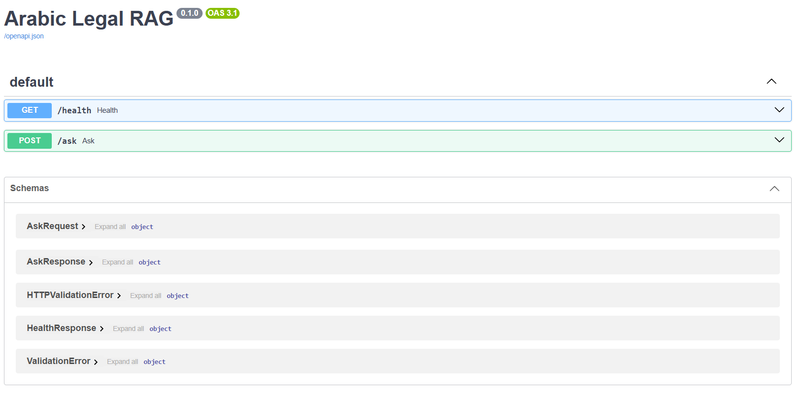

> 📷 **Bentoml** — Service page with /ask and /ask_stream.

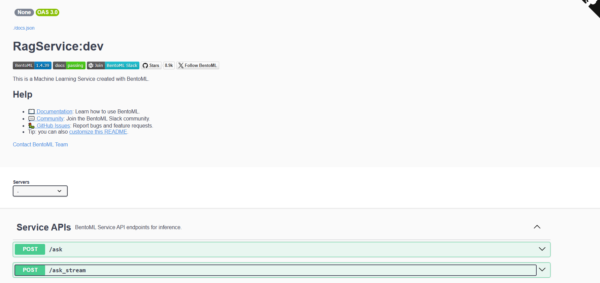

> 📷 **Streamlit** — Chat UI answering questions.

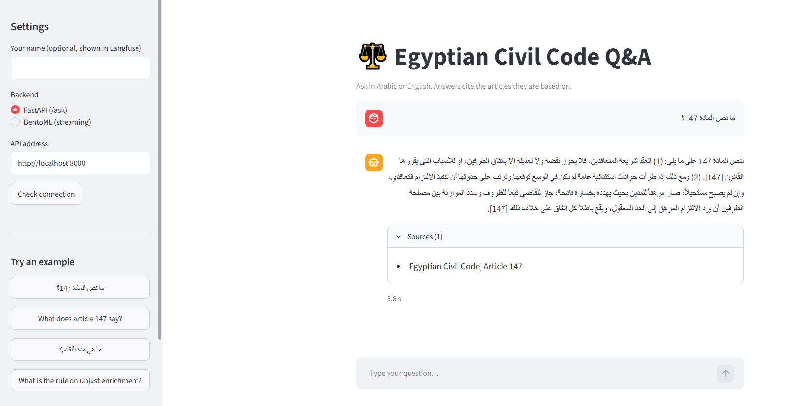

> 📷 **Locust** — 50-user load test statistics and charts.

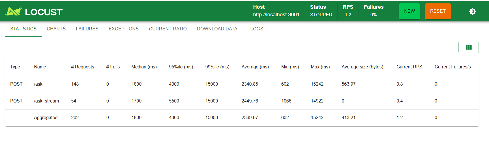

---

## Phase 9 — Optimization

**Goal:** make the system cheaper and faster, and prove it with a before/after report.

**Status: not performed.** The generator is used through an API and no GPU was available, so there is no model to quantize or self-host.

| Item                   | What it would involve                                                                          | Status                                                                                   |
| ---------------------- | ---------------------------------------------------------------------------------------------- | ---------------------------------------------------------------------------------------- |
| Baseline ("before")    | RAGAS metrics and p95 latency with fixed settings                                              | Quality metrics recorded in Phase 6 and 10; latency/VRAM not comparable for an API model |
| AWQ 4-bit quantization | Quantize an open model with domain calibration data, serve with vLLM, compare quality and VRAM | Not done (needs an NVIDIA GPU)                                                           |
| Re-ranker distillation | Train a small cross-encoder on a larger teacher's scores                                       | Not done; only worthwhile if the right article is retrieved but ranked low               |

Method and plan are described in the project notes; no numbers were invented.

---

## Phase 10 — Monitoring

**Goal:** know whether the live system is still good, and notice when it stops being good.

```
user ─► POST /ask ─► FastAPI (:8000) ─┬─► Langfuse (traces, scores)
                                      ├─► /metrics ◄── Prometheus (:9095) ─► Grafana (:3031)
                                      │                         └─► Alertmanager (:9093) ─► webhook
        BentoML (:3001) ──────────────┴─► Langfuse
        offline: ragas_monitor.py ─► MLflow "rag-monitoring"
```

**Steps**

1. **RAGAS trend:** run the evaluation repeatedly into the MLflow experiment `rag-monitoring`.
2. **Langfuse:** every `/ask` (FastAPI) and every `/ask` and `/ask_stream` (BentoML) is a trace with the user, session, tags, metadata, scores (`refused`, `source_count`), and a nested model call with token usage.
3. **Prometheus metrics:** request count, latency histogram, tokens, cost, rolling faithfulness, exposed at `/metrics`.
4. **Grafana dashboard** with request rate, p95 latency, tokens, cost and rolling faithfulness.
5. **Alert:** `rag_faithfulness_rolling < 0.80` for 5 minutes fires `LowFaithfulness`; Alertmanager sends a webhook notification.
6. Drift detection: **not done** (see [limitations](#not-done--limitations)).

**Commands**

```bash
# Langfuse (self-hosted) — or use Langfuse Cloud and set the keys in .env
docker compose -p langfuse -f ~/langfuse/docker-compose.yml up -d

# Prometheus + Grafana + Alertmanager
docker compose -p monitoring -f docker-compose.monitoring.yml up -d
docker compose -p monitoring -f docker-compose.monitoring.yml ps

# metrics page
curl -s localhost:8000/metrics | grep -E "rag_requests_total|rag_request_seconds"

# RAGAS trend into MLflow
uv run --no-sync python -m arabic_legal_rag.monitoring.ragas_monitor
```

Useful PromQL for the dashboard:

| Panel                | Query                                                                          |
| -------------------- | ------------------------------------------------------------------------------ |
| Request rate         | `rate(rag_requests_total[1m])`                                                 |
| p95 latency          | `histogram_quantile(0.95, sum by (le) (rate(rag_request_seconds_bucket[5m])))` |
| Tokens / s           | `rate(rag_tokens_total[5m])`                                                   |
| Cost so far          | `rag_cost_usd_total`                                                           |
| Rolling faithfulness | `rag_faithfulness_rolling`                                                     |

Send a user and a session to Langfuse by adding headers to the request (the Streamlit UI does this):

```bash
curl -X POST localhost:8000/ask -H "Content-Type: application/json" \
     -H "X-User-Id: sara" -H "X-Session-Id: demo-1" -d @/tmp/q_en.json
```

> 📷 **MLflow trend** — Run comparison of embedding and chunk configurations.


> 📷 **Langfuse** — one trace with its model call, tokens, user, session and scores.

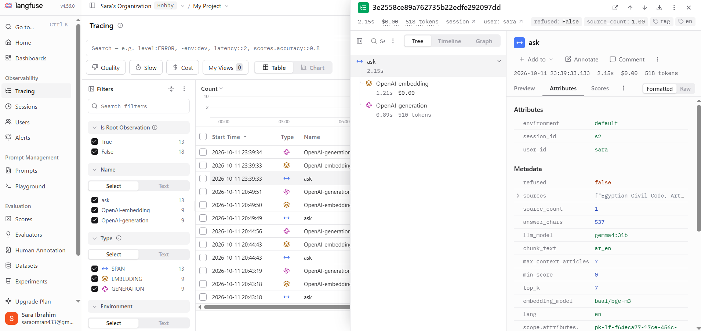

> 📷 **Prometheus** — **Status → Targets** with the `rag` job **UP**.

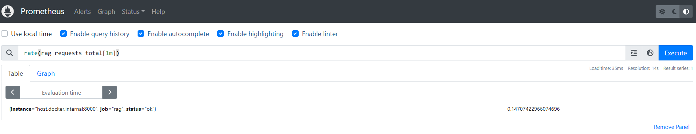

> 📷 **Grafana** — the five-panel dashboard.

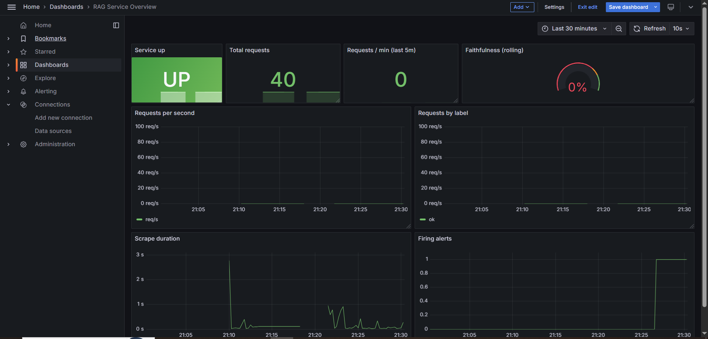

> 📷 **Alert fired** — `docs/images/alert_fired.png`: the firing alert and the received webhook message.

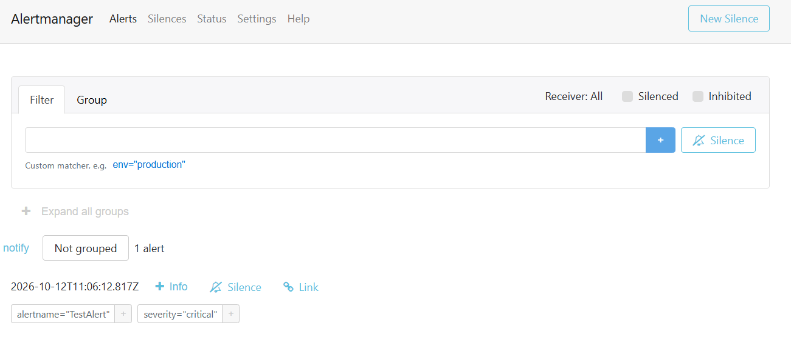

\_Langfuse used: **Langfuse Cloud**

---

## Port map

| Service      | Port | Start                                                                                                    |
| ------------ | ---- | -------------------------------------------------------------------------------------------------------- |
| FastAPI      | 8000 | `uv run --no-sync uvicorn arabic_legal_rag.api.main:app --port 8000`                                     |
| Streamlit UI | 8501 | `uv run --no-sync streamlit run ui/streamlit_app.py`                                                     |
| BentoML      | 3001 | `uv run --no-sync --env-file .env bentoml serve arabic_legal_rag.serving.service:RagService --port 3001` |
| Locust       | 8089 | `uv run --no-sync locust -f tests/load/locustfile.py --host http://localhost:3001`                       |
| MLflow       | 5000 | `uv run --no-sync mlflow server --host 127.0.0.1 --port 5000 …`                                          |
| Langfuse     | 3000 | `docker compose -p langfuse -f ~/langfuse/docker-compose.yml up -d`                                      |
| Prometheus   | 9095 | `docker compose -p monitoring -f docker-compose.monitoring.yml up -d`                                    |
| Grafana      | 3031 | (same compose file)                                                                                      |
| Alertmanager | 9093 | (same compose file)                                                                                      |
| nginx canary | 8080 | `docker compose -p canary -f docker-compose.canary.yml up -d`                                            |

---

## Design decisions

- **One chunk per article.** Legal citations are by article, so retrieval and citation use the same unit.
- **APIs for embeddings and the LLM.** No GPU is needed and the Docker image stays small.
- **Refuse instead of guess.** Low-similarity and off-topic questions and repealed articles get an explicit "not found" or "repealed" answer.
- **Retrieval depth matters.** Generic questions (for example "what is the prescription period?") can rank the key article below a small top-_k_; raising `top_k` fixes it at the cost of a longer prompt and more latency.
- **Tracing never breaks the API.** Without Langfuse keys tracing is off, and scoring errors are swallowed.
- **BentoML tracing needs a clean trace context.** BentoML wraps each request in its own span with sampling off by default, so Langfuse spans started inside it would be dropped silently. Each Langfuse trace therefore starts from an empty OpenTelemetry context.
- **Secrets only in `.env` and GitHub secrets**, never in git or in the image.

---

## Not done / limitations

- **vLLM serving and AWQ quantization:** not done. No GPU was available; the generator (Gemma 31B) is used through an API.
- **Re-ranker distillation:** not done; it is only worthwhile if retrieval metrics show the right article retrieved but ranked low.
- **Drift detection** (centroid cosine, MMD, domain-classifier AUC): not done.
- **Cost and token metrics:** Langfuse shows token usage when the provider returns it. A free model may return none, and its cost rounds to $0.00.
- **Retrieval is dense-only.** Very generic questions may need a larger `top_k` or hybrid retrieval.
- Answers depend on the generator and judge models; scores from a judge that is also the generator are optimistic.

---

## License and data

### Code

The source code in this repository is released under the **MIT License**

### Corpus

The corpus is the text of the **Egyptian Civil Code (Law No. 131 of 1948)**, processed into
`data/processed/civil_code.json` (1,094 articles, one article per chunk).

### Third-party models and services

| Component                                    | Used for                     | Terms                              |
| -------------------------------------------- | ---------------------------- | ---------------------------------- |
| `baai/bge-m3` via OpenRouter                 | Embeddings                   | Model licence and OpenRouter terms |
| Gemma 31B via Ollama                         | Answer generation            | Gemma Terms of Use                 |
| Langfuse, Prometheus, Grafana, MLflow, RAGAS | Observability and evaluation | Each project's own licence         |

### Disclaimer

This project is an educational and research prototype. It does not provide legal advice and
must not replace a qualified lawyer or the official text of the law.

---

## About the author

<div align="center">

**<Sara Ibrahim>**
<Your title, e.g. AI / ML Engineer · Data Scientist>

[](https://github.com/sara692)
[](https://www.linkedin.com/in/sara-ibrahim-omran>)
[](mailto:<saraomran433@gmail.com>)

</div>

**Feedback and contributions:** issues and pull requests are welcome at
[sara692/Egyptian-Civil-Code-QA](https://github.com/sara692/Egyptian-Civil-Code-QA/issues).
